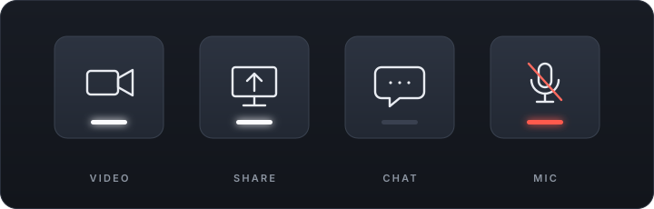
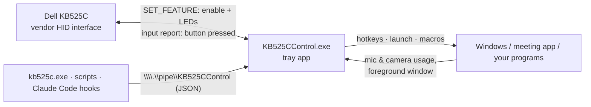
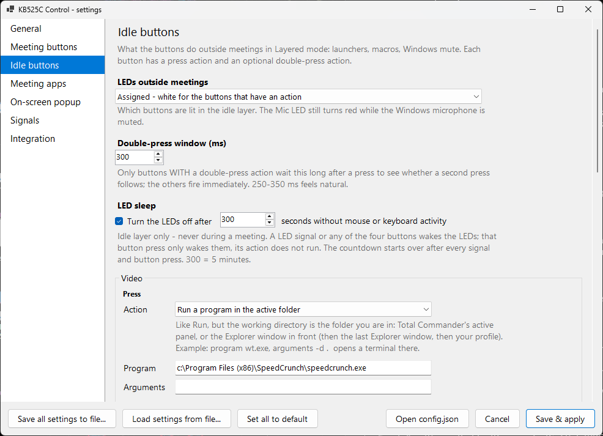
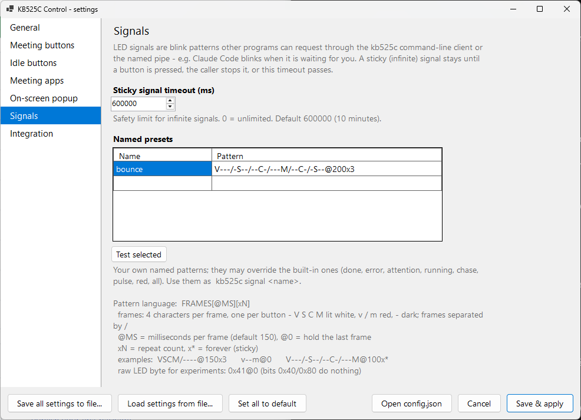

<p align="center">
  
</p>

<h1 align="center">KB525C Control</h1>

<p align="center">
  Make the four collaboration buttons of the <strong>Dell KB525C</strong> keyboard yours.<br>
  Meeting controls, launchers and macros on the buttons, a programmable LED row for your scripts —<br>
  <em>without</em> Dell Peripheral Manager and <em>without</em> Zoom.
</p>

<p align="center">
  <a href="LICENSE"></a>
  
  
  <a href="https://github.com/hollovar/KB525CControl/actions/workflows/build.yml"></a>
  <a href="https://github.com/hollovar/KB525CControl/releases"></a>
</p>

<p align="center">
  <a href="#quick-start">Quick start</a> ·
  <a href="#what-the-buttons-do">What the buttons do</a> ·
  <a href="#led-signals-for-your-scripts">LED signals</a> ·
  <a href="#claude-code-integration">Claude Code</a> ·
  <a href="docs/">Documentation</a> ·
  <a href="https://hollovar.github.io/kb525c/">Project page</a>
</p>

---

The Dell KB525C collaboration keyboard has four backlit buttons — **Video**, **Share**,
**Chat** and **Mic** — that out of the box work **only in Zoom**, and only while Dell Peripheral
Manager is running (not even Teams is supported by the factory integration). The buttons are
otherwise silent: the firmware does not send an event until something switches them on.

KB525C Control is a small Windows tray application that switches them on itself, over the keyboard's
own USB HID vendor interface, and gives them two lives:

- **In a meeting** — any application using the microphone (Teams, Google Meet, Zoom, Discord…) —
  the buttons do what the labels say: mute, camera, share, chat, with the LEDs showing the real
  state (white = on, red = muted / camera off).
- **Outside meetings** the same four buttons become **launchers and macros**: a terminal in the
  folder you are looking at, a calculator, Claude Code, a screenshot hotkey — each with an optional
  double-press action.

And the LED row is a **programmable indicator**: any script can make it blink through the `kb525c`
command-line client or a named pipe — "the build finished", "Claude Code is waiting for you" — and
a press on any button acknowledges the signal and can bring the right window to the front.

## Highlights

| | |
|---|---|
| **No Dell software needed** | Talks to the keyboard directly. Only the `DPMService` Windows service has to be disabled, because it holds the command channel exclusively ([why](#why-dpmservice-has-to-be-disabled)). |
| **Meeting detection that just works** | A meeting is "somebody is using the microphone", read from Windows' own capability tracking. No per-app hooks, no window-title guessing. |
| **Two layers, one keyboard** | Meeting layer during calls, idle layer otherwise; or force either one. |
| **Launchers that know where you are** | `RunInActiveFolder` opens a program in the folder of the Explorer window or Total Commander panel in front. |
| **Settings window + `config.json`** | Every option explained in place; the JSON stays available for scripting and version control. |
| **LED signals from anywhere** | `kb525c signal done`, a named pipe for any language, a tiny pattern language for your own animations. |
| **On-screen popup** | "Mic · muted", "Share · wt.exe in C:\Projects" — never steals focus. |
| **Tray icon mirrors the LEDs** | 2×2 dots for the four buttons; grey = no keyboard, blue = idle, white = meeting, red = muted. |
| **Self-contained** | Two single-file executables, no .NET installation required on the target machine. MIT licensed. |

## How it works



1. The tray app opens the keyboard's two vendor HID collections, sends the *enable* command and
   the LED bitmask, and reads button events (`Kb525cDevice.cs`).
2. A meeting is detected by polling Windows' microphone/camera usage registry
   (`MediaUsageMonitor.cs`); the meeting app in front is identified by process name and window
   title (`MeetingAppDetector.cs`) so the right shortcut is sent.
3. Buttons run configurable *actions* (`AppConfig.cs`, `TrayApp.cs`): smart meeting toggles,
   hotkeys, programs, macros.
4. Signals arrive on a named pipe (`Ipc/`) and are rendered on top of the current LED state
   (`SignalEngine.cs`, `LedPattern.cs`), restoring it when they end.

## Quick start

### 1. Get the executables

Either download the latest zip from the [**Releases**](https://github.com/hollovar/KB525CControl/releases)
page, or build it yourself (needs the [.NET 10 SDK](https://dotnet.microsoft.com/download)):

```powershell
git clone https://github.com/hollovar/KB525CControl.git
cd KB525CControl
.\tools\publish.ps1
```

Both ways you end up with:

```
dist\KB525CControl.exe    tray app (self-contained, ~50 MB)
dist\kb525c.exe           command-line client (~36 MB)
dist\install.ps1
dist\uninstall.ps1
```

### 2. Install

```powershell
powershell -ExecutionPolicy Bypass -File .\install.ps1
```

The script

1. checks whether the KB525C is connected,
2. copies the executables to `%LOCALAPPDATA%\KB525CControl\` and adds that folder to the user
   `PATH` (so `kb525c` works from any new terminal),
3. **disables the `DPMService`** service (a UAC prompt appears — see below),
4. registers the app to start at logon,
5. starts it.

Switches: `-NoAutostart`, `-KeepDellService`, `-Source <exe path>`.
Uninstall: `.\uninstall.ps1 -RestoreDellService`.

Look for the tray icon. Its menu opens on left and right click alike: **Status · Mode · Test
signal · Settings… · Open / Reload config.json · Log · Reconnect · Exit**.

### Why DPMService has to be disabled

Dell Peripheral Manager opens the keyboard's vendor command channel **exclusively** (without
`FILE_SHARE`). While it runs, no other program can control the collaboration buttons —
`CreateFile` fails with `ERROR_SHARING_VIOLATION (32)`. The tray icon turns grey and a balloon tells
you when this happens.

What you lose: the factory Zoom integration of the four buttons (the only application Dell's
software drives them for), and keyboard firmware updates through DPM. Regular keys, media keys and the F-row do **not** depend on the service.

There is no separate "Dell Peripheral Manager" entry in *Installed apps*: the service comes with
**Dell Peripheral Core**, part of **Dell Display and Peripheral Manager**, which also manages Dell
monitors. Hence *disabling the service* is the right move, not uninstalling the software. To undo:
`Set-Service DPMService -StartupType Automatic; Start-Service DPMService`.

## What the buttons do

Tray menu → **Mode** (or `"mode"` in the config):

| Mode | During a meeting | Outside meetings |
|---|---|---|
| `Layered` (default) | meeting layer | **idle layer**: launchers, macros, optional double press |
| `MeetingsOnly` | meeting layer | buttons dark and inert |
| `Always` | meeting layer | meeting layer, buttons always lit |

**Meeting layer** (single press, on purpose — the Mic button must react instantly):

| Button | Action | LED |
|---|---|---|
| Mic | mutes the Windows microphone **and** sends the mute shortcut of the meeting app in front | red while muted |
| Video | sends the camera shortcut of the meeting app in front | follows real camera usage |
| Share / Chat | send the matching shortcut of the meeting app in front | white |

Google Meet, Microsoft Teams and Zoom shortcuts ship in the config and can be fixed without
recompiling when an app changes them.

**Idle layer** — an example, the author's own setup:

| Button | Press | Double press |
|---|---|---|
| Mic | toggle the Windows microphone mute (LED red while muted — handy for Discord) | — |
| Video | [SpeedCrunch](https://speedcrunch.org/) calculator | — |
| Share | Windows Terminal in the **active folder** (`wt.exe -d .`) | — |
| Chat | Claude Code in the **active folder** (`wt.exe -d . claude`) | — |

"Active folder" means the folder you are looking at: Total Commander's source panel when it is in
front, otherwise the Explorer window in front, the desktop, the last Explorer window, then your
profile. Any button can also have a `double` action; a hotkey, a macro, a URL or a document work
just as well as a program.

**LED sleep** (on by default, 5 minutes; *Idle buttons* page or `idle.sleepAfterSeconds`, 0 = off):
after the set time without mouse or keyboard activity the idle-layer LEDs go dark. A signal or any of the four
buttons wakes them — that press only wakes, the button's action does not run — and the countdown
restarts after every signal and press. Never during a meeting.

The full list of action types, the macro format and the environment variables handed to launched
programs are in [docs/configuration.md](docs/configuration.md).

## Settings

Tray menu → **Settings…** (or `kb525c settings`). Seven pages, every option explained next to
its control; *Save & apply* validates and applies immediately.

<p align="center">
  
  
</p>

The underlying file is `%APPDATA%\KB525CControl\config.json` (tray menu → **Open config.json**,
**Reload config.json** after editing by hand). A condensed version of the setup above:

```jsonc
{
  "mode": "Layered",
  "idle": {
    "leds": "Assigned",                                  // white where an action exists
    "sleepAfterSeconds": 300,                            // LEDs dark after 5 min without input (0 = never)
    "mic":   { "press": { "kind": "ToggleMicMute" } },
    "video": { "press": { "kind": "RunInActiveFolder", "value": "C:\\Program Files (x86)\\SpeedCrunch\\speedcrunch.exe" } },
    "share": { "press": { "kind": "RunInActiveFolder", "value": "wt.exe", "arguments": "-d ." } },
    "chat":  { "press": { "kind": "RunInActiveFolder", "value": "wt.exe", "arguments": "-d . claude" } }
  },
  "signals": {
    "presets": { "bounce": "V---/-S--/--C-/---M/--C-/-S--@200x3" }   // used by the Claude Code hooks below
  }
}
```

> **Tip — CLI tools on a button.** Start them *through* Windows Terminal (`wt.exe -d . claude`)
> rather than directly (`claude.exe`). A program launched straight from the tray app gets a plain
> console host without `WT_SESSION`, so tools like Claude Code run without colours.

Everything else — the `apps` shortcut table, the on-screen popup, editor, menu font size, sticky
timeout — is documented in [docs/configuration.md](docs/configuration.md).

## LED signals for your scripts

The button row is a programmable indicator. A signal is a sequence of frames that the tray app
plays *on top of* the current state and then restores it.

```powershell
kb525c signal done                          # built-in pattern: three white flashes
kb525c signal "V---/-S--/--C-/---M@80x3"    # running light, left to right, three times
kb525c signal bounce --sticky               # your own preset, until a button is pressed
kb525c signal attention --sticky --ack focus:WindowsTerminal --label "CI failed"
kb525c run --label tests -- npm test        # running light while it runs, done/error by exit code
kb525c off                                  # stop everything
```

The pattern language is one line: `FRAMES[@MS][xN]`, where a frame is four characters in the
order **V**ideo **S**hare **C**hat **M**ic — upper case white, lower case red (`v`, `m` only:
the hardware has no red for Share and Chat), `-` dark. `@200` = 200 ms per frame, `x3` = three
times, `x*` = forever (a *sticky* signal that waits to be acknowledged).

| Pattern | Effect |
|---|---|
| `VSCM/----@150x5` | the whole row flashes five times |
| `V---/-S--/--C-/---M/--C-/-S--@200x3` | **bounce**: a light running left → right → left |
| `v--m/----@250x*` | red alarm until acknowledged |
| `VSCM@0` | all white, held |

Pressing any button while a signal plays means "seen": the signal stops, a popup shows its label,
and the optional `--ack` action runs (`focus:<process>`, `run:<command>`, `hotkey:<combo>`). The
button's normal function does not fire on that press.

Full CLI reference, queueing and priorities, `kb525c watch`, exit codes:
[docs/signals.md](docs/signals.md). The wire protocol behind the CLI — one JSON line in, one out
on `\\.\pipe\KB525CControl`, usable from PowerShell, Python or anything else:
[docs/pipe-protocol.md](docs/pipe-protocol.md).

## Claude Code integration

Claude Code can run a shell command on certain events (*hooks*). Two of them map naturally onto the
keyboard: **Stop** — Claude finished its answer — and **Notification** — Claude is waiting for a
permission or for your input. With the hooks below, the LED row bounces until you press a button,
and that press brings Windows Terminal to the front.

**1. Define the pattern.** The hooks use a preset called `bounce`. Add it in *Settings → Signals →
Named presets* (Name `bounce`, Pattern `V---/-S--/--C-/---M/--C-/-S--@200x3`, *Test selected* to
watch it), or in `config.json` under `signals.presets` as shown above. Any pattern name works
here — a built-in like `attention` too — but a preset you named is easier to tweak later.

**2. Add the hooks** to `~/.claude/settings.json` (`%USERPROFILE%\.claude\settings.json`). The
*Settings → Integration* page has a *Copy template* button with exactly this text, and shows the
hooks currently in effect:

```jsonc
{
  "hooks": {
    "Stop": [
      { "hooks": [ { "type": "command", "timeout": 5,
          "command": "\"$LOCALAPPDATA/KB525CControl/kb525c.exe\" signal bounce --sticky --label \"Claude Code finished\" >/dev/null 2>&1 || true" } ] }
    ],
    "Notification": [
      { "matcher": "permission_prompt|idle_prompt",
        "hooks": [ { "type": "command", "timeout": 5,
          "command": "\"$LOCALAPPDATA/KB525CControl/kb525c.exe\" signal bounce --sticky --ack focus:WindowsTerminal --label \"Claude Code is waiting\" >/dev/null 2>&1 || true" } ] }
    ]
  }
}
```

**3. Start a new Claude Code session** — hook changes are read at startup.

**4. Test it** without waiting for Claude: `kb525c signal bounce --sticky --label test`, then press
any collab button. The popup shows the label, the LEDs return to normal.

What the pieces mean:

- `--sticky` — keep bouncing until a button is pressed (or `signals.stickyTimeoutMs`, default
  10 minutes, passes). Drop it on the Stop hook if you prefer three bounces and silence.
- `--ack focus:WindowsTerminal` — the acknowledging press also brings Windows Terminal to the
  front. Use your terminal's process name (`WindowsTerminal`, `Code`, `alacritty`…).
- `--label` — what the popup says when you acknowledge, so you know which event it was.
- `>/dev/null 2>&1 || true` — **do not leave this out.** Claude Code treats a hook exit code of
  `2` as a blocking error, and `kb525c` returns exactly 2 when the tray app is not running.
  `|| true` keeps a stopped tray app from interfering with Claude.
- The commands run in Git Bash (Claude Code's default shell on Windows), hence `$LOCALAPPDATA`
  and `/dev/null`.

More on hooks, other editors and CI scripts: [docs/integrations.md](docs/integrations.md).

## Troubleshooting

- **Tray icon grey, balloon "command channel is busy"** — `DPMService` is running. Disable it
  (`install.ps1` does; or `Set-Service DPMService -StartupType Disabled; Stop-Service DPMService`
  as administrator).
- **It worked, then stopped after a Dell update** — updating Dell Display and Peripheral Manager
  reinstalls `DPMService` with automatic start. Disable it again with the command above.
- **"Keyboard not detected"** — plug in the KB525C; a different Dell model is reported with its
  PID. Tray menu → **Reconnect** after a sleep/resume if needed.
- **A meeting button does nothing in the app** — shortcuts only reach the **focused** window.
  Bring the meeting window to the front; the OS-level mute still happens regardless.
- **Which folder, which app, which layer?** Tray menu → **Log** (live, copyable) or
  `kb525c log 80`. `kb525c status --json` gives the state machine-readably; `kb525c press share`
  triggers a binding without touching the keyboard.

Known limitations are listed in [docs/configuration.md](docs/configuration.md#known-limitations).

## Building from source

- Windows 10/11, [.NET 10 SDK](https://dotnet.microsoft.com/download).
- `dotnet build KB525CControl.slnx -c Release` builds both projects; `KB525CControl.slnx` opens in
  Visual Studio 2022 17.12+ / VS 2026.
- `tools\publish.ps1` produces the self-contained single-file executables in `dist\`.
- Dependencies: [HidSharp](https://www.nuget.org/packages/HidSharp) (USB HID),
  [NAudio](https://www.nuget.org/packages/NAudio) (microphone mute). Windows Forms for the tray,
  settings, popup and log windows.

```
KB525CControl/            tray application (net10.0-windows, WinForms)
  Kb525cDevice.cs         the keyboard: enable command, LED bitmask, button events
  TrayApp.cs              state machine, layers, actions, tray icon
  SignalEngine.cs         signal queue, sticky signals, acknowledgement
  LedPattern.cs           the pattern language
  Settings/               settings window
  Ipc/                    named-pipe server, protocol, client (shared with the CLI)
KB525CCli/                kb525c command-line client (net10.0)
tools/                    publish.ps1, install.ps1, uninstall.ps1
docs/                     reference documentation
```

Bug reports and pull requests are welcome — see [CONTRIBUTING.md](CONTRIBUTING.md).

## Documentation

| | |
|---|---|
| [docs/configuration.md](docs/configuration.md) | modes, `config.json` reference, action types, macros, environment variables, known limitations |
| [docs/signals.md](docs/signals.md) | `kb525c` command reference, pattern language, signal behaviour, exit codes |
| [docs/pipe-protocol.md](docs/pipe-protocol.md) | the named-pipe JSON protocol with PowerShell and Python samples |
| [docs/integrations.md](docs/integrations.md) | Claude Code hooks, build scripts, other tools |
| [CHANGELOG.md](CHANGELOG.md) | release notes |

## Compatibility and credits

Tested with the Dell KB525C (USB `413C:2123`, firmware 0x1021) on Windows 11. The keyboard is
made by Primax for Dell; the protocol used here was worked out by observing what Dell Peripheral
Manager sends and confirming it from an independent program. Only the documented *collaboration
keys* command is used; the firmware-update interface is never touched.

Not affiliated with Dell Technologies. Dell, Zoom, Microsoft Teams and Google Meet are trademarks
of their respective owners.

Written by András Bükki-Deme · [Hollovar Labs](https://hollovar.github.io/) · MIT License.
